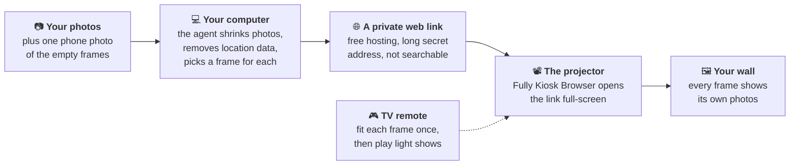

# Projection Photo Wall

https://github.com/user-attachments/assets/a0a651e8-bec8-4e14-90d1-9d56c1ecf929

<p align="center"><sub>The 90-second explainer (turn the sound on). Full quality: <a href="docs/media/explainer.mp4">docs/media/explainer.mp4</a></sub></p>

Turn a wall of empty picture frames into a living photo wall: a small projector warps a separate photo stream
into each frame, changes one frame at a time with a slow zoom, draws a glowing Kolam line across the wall
between photos, and on demand plays one-minute sound-and-light shows with original music. Everything runs in
one web page, aligned with a TV remote, on an Android projector in a kiosk browser.

**No coding needed.** If you have an AI coding agent (Claude Code or similar), point it at this repo and say
*"Set up my photo wall following AGENTS.md"*. It does the computer part and tells you, one step at a time, what
to do on the wall and the projector.

## How it works



In plain words: your photos are prepared on your computer and put on a private web page. The projector opens
that page and shines one photo into each empty frame. You use the remote once to nudge each picture so it fits
its frame exactly; after that the wall runs by itself, changing photos every minute, and plays a light show with
music whenever you pick one from the remote.

## Setting it up, step by step

| # | Step | Who does it |
|---|---|---|
| 1 | Hang the frames and take the glass out (glass reflects the light) | you |
| 2 | Put your photos in a folder and take a straight-on phone photo of the wall | you |
| 3 | Prepare the photos and describe the frames | the agent |
| 4 | Create a free Cloudflare account, then publish the private link | you create the account ([how](#cloudflare-account-required)); the agent publishes |
| 5 | Install Fully Kiosk Browser on the projector and type in the short link | you, guided by the agent |
| 6 | Point the projector at the wall, focus it, then **never move it again** | you |
| 7 | Fit each frame with the remote's arrow keys (a minute or two per frame) | you |

No agent? After creating the Cloudflare account, steps 3 and 4 are four commands (see [Quick start](#quick-start)); anyone comfortable with a
terminal can run them for you. To change the photos later, only steps 3 and 4 are repeated.

## What you need

- Picture frames on a wall, glass removed (any number, any mix of sizes).
- An Android projector (or a projector plus an Android TV box / Fire TV stick) that can sit 1 to 2 m from the
  wall. Tested on a 720p/1080p portable Android 13 projector; see [docs/hardware.md](docs/hardware.md).
- **On an Android projector, use [Fully Kiosk Browser](https://www.fully-kiosk.com/)** to run the wall. It is
  what this project was built and tested with: full-screen, keeps the screen on, starts on boot, passes the
  remote's keys to the page and allows the music to autoplay. Setup: [docs/projector-kiosk.md](docs/projector-kiosk.md).
- Your photos, a computer with Python 3 (and Node 18+ for publishing).
- **A free Cloudflare account (required).** The wall is published on Cloudflare Pages, which gives it the web
  address the projector opens. No domain and no payment card needed; see [below](#cloudflare-account-required).

## Quick start

```bash
python3 -m pip install pillow
# 1. Describe your frames: edit site/config.js (or click corners on a wall photo: tools/mark-frames.html)
# 2. Prepare photos (resize, strip location data, assign to frames):
python3 tools/prepare-album.py ~/Pictures/wall-photos
# 3. Preview:
./serve.sh                     # http://localhost:8000/  (and /#play)
# 4. Publish (unlisted URL) and put the short link in Fully Kiosk Browser on the projector:
./deploy-cloudflare.sh
```

Then align each frame with the remote: any arrow opens the menu, **Align frames**
([docs/alignment.md](docs/alignment.md)).

## Cloudflare account (required)

Every wall is published to Cloudflare Pages. That is what gives you a web address the projector (or a laptop)
can open from anywhere. It is free, and you don't need a domain name or a payment card.

### 1. Create the account (about 3 minutes)

1. Go to **[dash.cloudflare.com/sign-up](https://dash.cloudflare.com/sign-up)**, enter your email and a
   password, and select **Sign up**.
2. Open the email from Cloudflare and click the **verification link**. Do this before publishing: Cloudflare
   can refuse to publish from an account whose email isn't verified.
3. If the dashboard asks you to add a website or domain, or to choose a plan, skip it. The wall uses a free
   `something.pages.dev` address, so no domain and no paid plan are needed.

### 2. Let the publish tool use your account (once)

The first time `./deploy-cloudflare.sh` runs (you or your agent), a browser tab opens on Cloudflare asking
whether **Wrangler** (Cloudflare's own publishing tool) may make changes to your account. Make sure you're
signed in to the account you just created, then select **Allow**. Close the tab and return to the terminal; it
carries on by itself. If you have more than one Cloudflare account, the terminal asks which one to use.

### 3. What to enable in the dashboard

**Nothing needs switching on.** The script creates the Pages project and publishes it as the *production*
site, and a production `*.pages.dev` address is public by default. To check, open
[dash.cloudflare.com](https://dash.cloudflare.com) → **Workers & Pages** → your `photowall-…` project:

| Where | What you should see |
|---|---|
| **Deployments** | the newest deployment marked **Production**, branch `main` |
| **Settings → General → Access policy** | **off** (it only affects preview copies, but leave it off) |
| **Zero Trust → Access → Applications** | no application covering your `photowall-….pages.dev` address. One would put a login screen in front of the wall, and the projector can't get past it |
| **Custom domains** | nothing needed; the `pages.dev` address is enough |

### 4. Check the address is public

The script ends by printing a **short link**, such as `photowall-1a2b3c.pages.dev/k7qx9m`. Open it on a phone
using **mobile data** (Wi-Fi off) in a private browser tab. You should see the wall, with no login screen. A
brand-new address can take a few minutes to start working; if you get "site can't be reached", wait five
minutes and try again. Only the short link and the wall address work: the bare `photowall-….pages.dev`
address shows "Not found" on purpose. More help: [docs/hosting.md](docs/hosting.md#troubleshooting).

## On the wall

| Remote menu | What it does |
|---|---|
| Kolam now | the Kolam scene with its own music (the automatic one every 2 minutes is silent) |
| Light show | all five shows back to back, ~5 min |
| Skyfire, Laser tide, Prism, Neon grid, Phoenix | one show each, ~1 min with music |
| Sound test | a chime and the audio status |
| Align frames | per-frame alignment; its menu has Alignment QR to back up the alignment |

OK or Back stops a show. Photos change one frame at a time, each frame once a minute.

## Repo layout

| Path | What it is |
|---|---|
| `site/index.html` | the whole app (editor, kiosk mode, scenes, shows, audio) |
| `site/config.js` | your frames (names, shapes, optional corners on a wall photo) |
| `site/album.js`, `site/album/` | your photos, written by `tools/prepare-album.py` (git-ignored) |
| `site/alignment.json` | optional default alignment (from Alignment QR) |
| `site/music/` | pre-rendered show music (original, made from the scores in index.html) |
| `tools/prepare-album.py` | resize, strip EXIF, assign photos to frames, write album.js |
| `tools/mark-frames.html` | click frame corners on a wall photo, get config.js entries |
| `tools/make-demo-photos.py` | placeholder photos for a dry run |
| `tools/render-music.sh` | re-render the music after editing a score |
| `deploy-cloudflare.sh`, `serve.sh` | publish to Cloudflare Pages / preview locally |
| `docs/` | hardware, configuration, hosting, projector, alignment, customizing, troubleshooting |

## Privacy

Photos stay out of git. When published, they sit on a public-but-unlisted site: a long random path, no index,
no search engines, no referrer. That is obscurity, not access control; anyone with the full URL can see them.
Keep the wall's address to your household, and see `docs/hosting.md` for the details.

## License

MIT, including the music in `site/music/` (original compositions generated from the scores in `index.html`).
